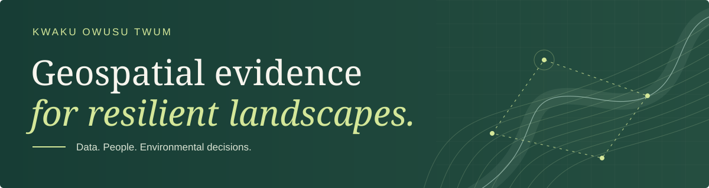

# Kwaku Owusu Twum

**Geospatial researcher · Environmental governance · PhD candidate, University of Waterloo**

I develop spatial analysis, research and digital tools that help people understand environmental change and act on evidence. My work connects GIS and Earth observation with statistical analysis, policy research and engagement with farmers, landowners and institutions.

Across Canada and Ghana, I work on conservation in working landscapes, flood-risk evidence, environmental monitoring and agricultural data systems. I also co-founded Mapkot Technologies, where I contribute to product strategy, user research, geospatial analytics and partnerships.

**[Explore my website](https://kwaku-o-twum.github.io/)** · **[Portfolio PDF](https://kwaku-o-twum.github.io/downloads/Kwaku_Owusu_Twum_Portfolio.pdf)** · **[CV](https://kwaku-o-twum.github.io/downloads/Kwaku_Owusu_Twum_CV.pdf)** · **[Get in touch](mailto:kotwum@uwaterloo.ca)**

## Selected work

These case studies explain the question, my contribution, the approach and the project's current scope.

| Project | What I work on |
| :--- | :--- |
| **[DefenseIQ](https://kwaku-o-twum.github.io/projects/defenseiq.html)** · Climate Risk Research Group | Organizing flood-defence documents, protection standards and source references into structured evidence and spatial outputs for research and scenario development. |
| **[Canadian conservation research](https://kwaku-o-twum.github.io/projects/conservation.html)** · University of Waterloo and collaborators | Conservation easements, OECMs and landowner participation: connecting spatial, quantitative and institutional research in working landscapes. |
| **[Environmental monitoring at Koa](https://kwaku-o-twum.github.io/projects/koa.html)** · Ghana and Switzerland | Satellite-based deforestation monitoring, geospatial analysis and sustainability data systems for cocoa sourcing and operations. |
| **[Mapmate / Mapkot](https://kwaku-o-twum.github.io/projects/mapmate.html)** · Agricultural digital products | Product strategy, user research and geospatial analytics for team-developed tools connecting farm profiles, mapping, operational records and communication. |

## Research and writing

My doctoral research examines how digital agriculture becomes part of farming, what ecological changes become visible, and the conditions that connect information with sustainability decisions.

- **Urban heat:** [Mapping urban heat dynamics in Sub-Saharan Africa](https://doi.org/10.1080/19376812.2026.2742326) — *African Geographical Review*, 2026; first author.
- **Conservation policy:** [The social fit of conservation policy on working landscapes](https://doi.org/10.1016/j.rama.2025.01.009) — *Rangeland Ecology & Management*, 2025; co-author.
- **Policy analysis:** [Barriers to Adoption: Digital Agriculture in Ontario's Food Production Landscape](https://capi-icpa.ca/wp-content/uploads/2025/05/2025-05-23-Kwaku-Twum-Digital-Agriculture-EN.pdf) — Canadian Agri-Food Policy Institute, 2025; author.

[More publications and policy reports](https://kwaku-o-twum.github.io/#research)

## Methods and tools

- **Spatial analysis and monitoring:** ArcGIS Pro, QGIS, Google Earth Engine, remote sensing and spatial data quality.
- **Data and research:** Python, R, SPSS, survey research, qualitative analysis, evidence synthesis and policy analysis.
- **Putting evidence to work:** Geospatial product development, maps and visualizations, technical documentation and research communication.

## Background

I am completing a **PhD in Sustainability Management**, a **Master of Business, Entrepreneurship and Technology**, and a **Graduate Diploma in Climate Change** at the University of Waterloo. I hold an MPhil in Geographic Information Systems and a BSc in Human Settlement Planning from KNUST, Ghana.

Previously, I was a **2024–2025 Doctoral Fellow at the Canadian Agri-Food Policy Institute** and progressed from **GIS Analyst to Head of Data and IT at Koa**.

## Collaborate

I welcome research collaborations and opportunities in conservation GIS, environmental data analysis, climate risk and geospatial product development.

**[kotwum@uwaterloo.ca](mailto:kotwum@uwaterloo.ca)** · **[University of Waterloo profile](https://uwaterloo.ca/complexity-innovation/profiles/kwaku-owusu-twum)** · **[Website source](https://github.com/kwaku-o-twum/kwaku-o-twum.github.io)**
